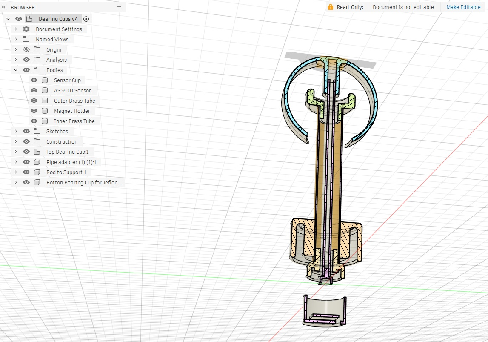

This is code for a rooftop wind vane that reports wind direction via wired link to a 
in house graphical LCD display with wind rose and wind pointer. It also sends temperature and humidity. The code includes provision for pan/ tilt motor controls for 
an IP camera mounted on the same pole as the wind vane (assuming the camera has serial output for that function). An ESP32C3 is used in the 3/4" PVC sprinkler pipe 
holding the wind vane and optional camera. The ESP32C3 has WiFi and creates a local web page, so you can see the compass rose and pointer on your phone. 
Additionally, new firmware can be uploaded via the web page if desired. A WiFi hotspot is also created if you want to connect directly.

The display is 2.4" TFT SPI 240 x 320, microcontroller is a teensy 3.2. The wind rose has a pointer for the wind vane, and a separate pointer for an
optional sonic wind speed and direction sensor. That optional sensor uses a modbus protocol, so needs a modbus adapter at both ends, similar to the wind vane that uses a rs 485
adapter at both ends. The wind direction arrows are red for wind vane and blue for the sonic wind direction; they are at different heights on the pole, so 
often read slightly different directions. The wind vane is much more sensitive to low wind speeds due to its low friction design.

