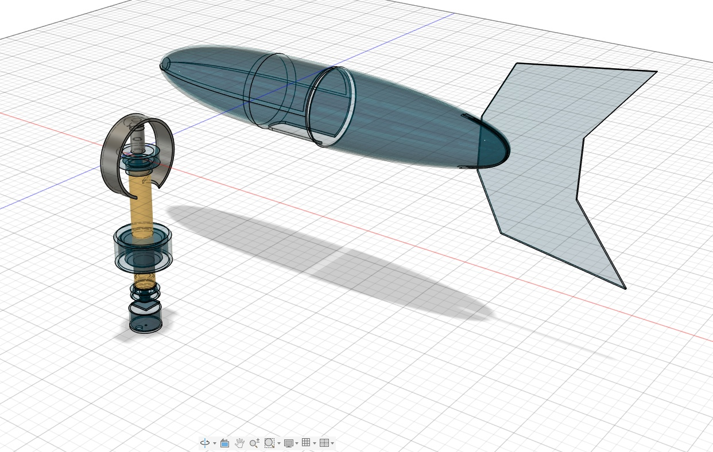
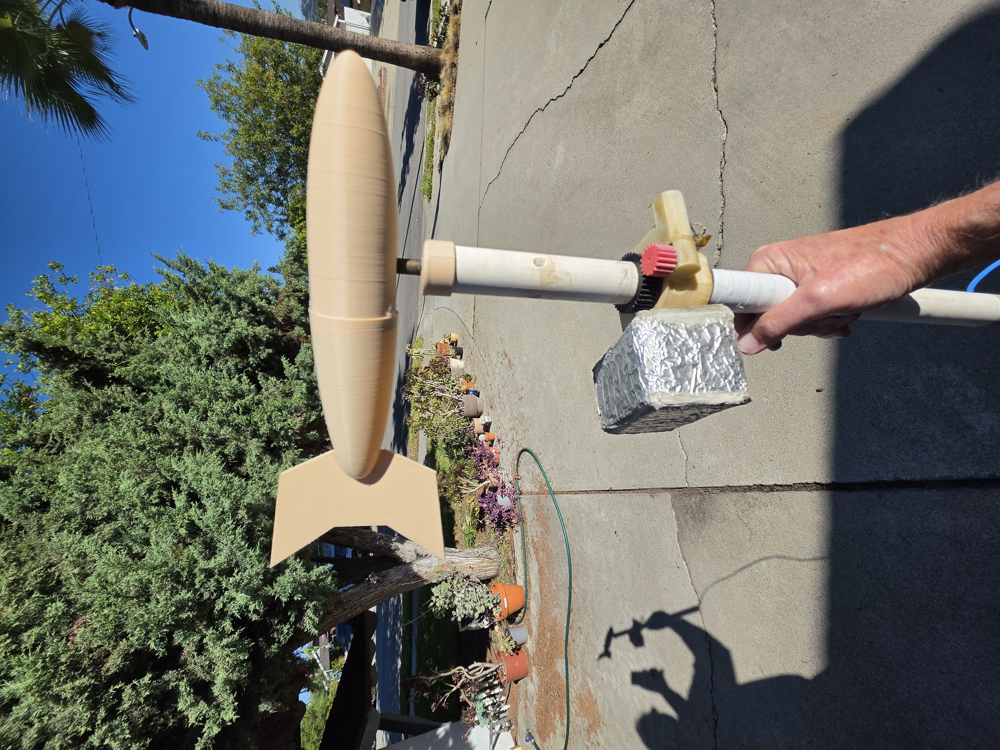
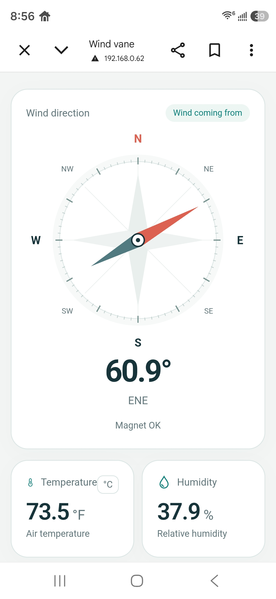
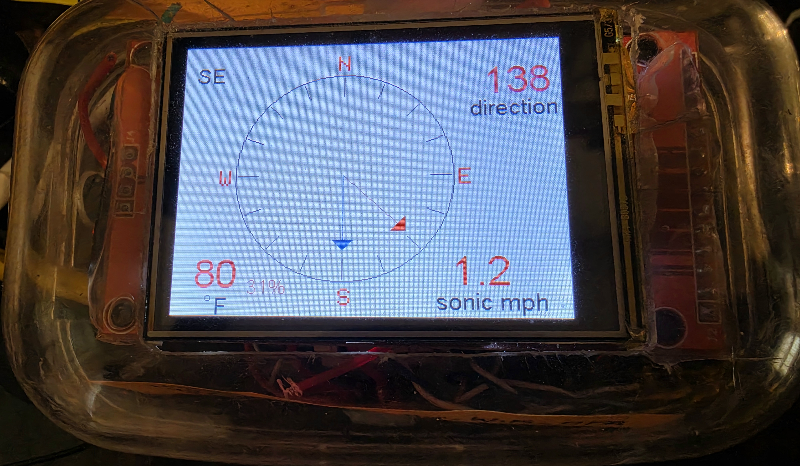
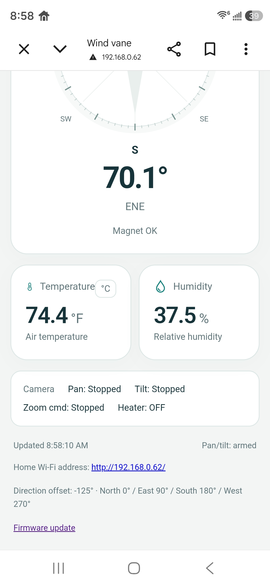

# WindVane

A low-friction rooftop wind vane with a wired indoor compass display and a
local Wi-Fi dashboard. The rooftop unit measures wind direction, temperature,
and humidity. The indoor display can also read an optional sonic
anemometer for wind speed and a second direction reading.

## Firmware

| Sketch | Hardware | Purpose |
| --- | --- | --- |
| [Rooftop firmware](HW675_Wind_PanTilt_WiFi_OTA/HW675_Wind_PanTilt_WiFi_OTA.ino) | HW675 ESP32-C3 | Reads the vane and weather sensors, sends wired weather data, serves the Wi-Fi dashboard, and supports browser firmware updates and optional camera pan/tilt. |
| [Indoor display firmware](Wind_Vane_Sonic_Calm_Hold/Wind_Vane_Sonic_Calm_Hold.ino) | Teensy 3.2 and 2.4-inch 240 × 320 ILI9341 SPI TFT | Displays the vane direction in red and the optional sonic direction in blue. |

The rooftop sketch uses the Arduino ESP32 board package and U8g2 for the
local OLED. The indoor sketch uses Teensy board support, `ILI9341_t3`,
`font_Arial.h`, and `movingAvg`.

## Vane and sensors

A diametrically magnetized magnet turns with the vane shaft. A stationary
AS5600 below the magnet reads the shaft angle over I²C, so the vane can turn
freely without a slip ring. The top bearing should spin freely without
rubbing seals or heavy grease. A loose-fitting PTFE sleeve supports the
bottom of the shaft and keeps a metal bearing away from the AS5600. The
original build uses a small AS5600 adapter board to fit the bearing holder.

The ESP32-C3 is mounted inside the 3/4-inch PVC support pipe. The AS5600,
SHT3x temperature/humidity sensor, and local OLED share the 3.3 V I²C bus
on GPIO5 (SDA) and GPIO6 (SCL). The AS5600 uses address `0x36`. The
firmware checks for an SHT3x at `0x44` or `0x45`.

## Wired links and north calibration

- The rooftop sketch sends direction, temperature, and humidity from
  GPIO10 at 115200 baud, 8N1. The Teensy receives this stream on `Serial1`.
  Use line transceivers for the outdoor cable.
- The optional sonic anemometer uses Modbus RTU over a separate RS-485
  connection on Teensy `Serial3` at 4800 baud. Set `sonicConnected` to
  `false` in the indoor sketch if no sonic sensor is installed.
- The optional camera interface accepts Pelco-D commands at 9600 baud
  through a suitable receiver on GPIO7. The ESP32-C3 drives the pan/tilt
  motors through a DRV8833.
- After mounting the vane, point it north and check both displays.
  Adjust `WEB_DIRECTION_OFFSET_DEG` in the rooftop sketch and the
  `displayAngle` offset in the indoor sketch for your installation.

## Wi-Fi dashboard and firmware updates

Join the vane's Wi-Fi hotspot and open <http://192.168.4.1/>. If the
ESP32-C3 is configured to join your home Wi-Fi, open its LAN IP address
instead. The dashboard shows the compass pointer, temperature, and humidity.

For a browser firmware update, open `/update` on the vane and upload the
compiled application file `HW675_Wind_PanTilt_WiFi_OTA.ino.bin`.

## Build photos and displays

